<div align="center">

<!-- ═══════════════════════════════════════════════ HEADER ═══════════════════════════════════════════════ -->



<br/>

<!-- Typing Animation -->
[](https://git.io/typing-svg)

<br/>

<!-- Social Badges -->
[](https://www.linkedin.com/in/shibil-t/)
[](mailto:shibilvpr@gmail.com)
[](https://github.com/shibilvpr)
[](https://maps.google.com/?q=Perinthalmanna,Kerala,India)

<br/>

</div>

---

<!-- ═══════════════════════════════════════════════ ABOUT ME ═══════════════════════════════════════════════ -->

<div align="center">

## 🔴 About Me

</div>

```javascript
const shibil = {
  name        : "Shibil T.",
  title       : "Full Stack Web Developer | MERN Stack Developer",
  location    : "Perinthalmanna, Malappuram, Kerala, India ",
  github      : "github.com/shibilvpr",
  email       : "shibilvpr@gmail.com",
  linkedin    : "linkedin.com/in/shibil-t/",

  education   : [
    "Full Stack Web Development — GCE Perinthalmanna",
    "B.A. English Language & Literature — University of Calicut "
  ],

  stack       : ["React.js", "Node.js", "Express.js", "MongoDB", "Next.js"],
  currentFocus: "Building scalable MERN stack applications",
  funFact     : "I turn complex problems into elegant, user-friendly solutions ",
  openTo      : ["Full Stack Roles", "Freelance Projects", "Open Source Collaboration"]
};
```

<br/>

<div align="center">

| Focus | Learning | Open To |
|:---:|:---:|:---:|
| MERN Stack Apps | Next.js & TypeScript | Full-time / Freelance |
| REST API Design | Cloud Deployments | Open Source Collaboration |
| Scalable Architecture | DevOps Basics | Remote & On-site Roles |

</div>

<br/>

---

<!-- ═══════════════════════════════════════════════ QUOTE ════════════════════════════════════════════════ -->

<div align="center">



</div>

---

<!-- ═══════════════════════════════════════════════ SKILLS ═══════════════════════════════════════════════ -->

<div align="center">

## Tech Stack & Skills

</div>

<div align="center">

### ⚡ Frontend Development


### 🔧 Backend Development


### 🗄️ Database


### 🧰 Tools & Platforms


</div>

<br/>

---

<!-- ═══════════════════════════════════════════════ FEATURED PROJECT ═══════════════════════════════════════ -->

<div align="center">

## 💎 Featured Project Spotlight

</div>

<div align="center">

### 🏆 NYRA JEWELLERS — Luxury E-Commerce Platform

</div>

<div align="center">

```
  ███╗   ██╗██╗   ██╗██████╗  █████╗
  ████╗  ██║╚██╗ ██╔╝██╔══██╗██╔══██╗
  ██╔██╗ ██║ ╚████╔╝ ██████╔╝███████║
  ██║╚██╗██║  ╚██╔╝  ██╔══██╗██╔══██║
  ██║ ╚████║   ██║   ██║  ██║██║  ██║
  ╚═╝  ╚═══╝   ╚═╝   ╚═╝  ╚═╝╚═╝  ╚═╝
        J E W E L L E R S — Luxury MERN E-Commerce
```

</div>

<br/>

<table align="center">
<tr>
<td width="50%" valign="top">

#### 📌 Project Overview
A full-featured **luxury jewellery e-commerce platform** built from the ground up using the MERN stack. Designed to offer a seamless, high-end shopping experience with a robust admin management system.

#### 🚀 Core Features
- 💍 Jewellery Product Listing & Detail Pages
- 🛒 Shopping Cart & Wishlist
- 🎨 Product Variants (Color, Size, Weight)
- 🔐 Secure User Authentication (JWT)
- 📦 Order Management System
- 🖼️ Cloudinary Image Management
- ✉️ Email Verification System

</td>
<td width="50%" valign="top">

#### 🛠️ Tech Stack


#### 👔 Admin Features
- 📊 Admin Dashboard
- 📁 Product & Category Management
- 📋 Order Status Management
- 👥 User Management & Access Control

</td>
</tr>
</table>

<br/>

---

<!-- ═══════════════════════════════════════════════ OTHER PROJECTS ════════════════════════════════════════ -->

<div align="center">

## 📁 Other Projects

</div>

<div align="center">

<table>
<tr>

<td align="center" width="220">
<br/>
🏥
<br/><br/>
<b>Hospital Management System</b>
<br/><br/>
A full-featured hospital management platform for patient records, appointments, and staff coordination.
<br/><br/>


<br/>

[](https://github.com/shibilvpr/HOSPITALMANAGMENT)

</td>

<td align="center" width="220">
<br/>
🏠
<br/><br/>
<b>Rental Home Management System</b>
<br/><br/>
A property rental management web app with listing, booking, and tenant management features.
<br/><br/>


<br/>


</td>

<td align="center" width="220">
<br/>
🎂
<br/><br/>
<b>Cake Shop E-Commerce</b>
<br/><br/>
An online bakery e-commerce store with product catalog, cart, and order placement functionality.
<br/><br/>


<br/>


</td>

<td align="center" width="220">
<br/>
⚡
<br/><br/>
<b>Electros E-Commerce</b>
<br/><br/>
A full-stack electronics e-commerce platform with admin dashboard, product management, and user auth.
<br/><br/>


<br/>


</td>

</tr>
</table>

</div>

<br/>

---

<!-- ═══════════════════════════════════════════════ GITHUB STATS ══════════════════════════════════════════ -->

<div align="center">

## 📊 GitHub Analytics & Statistics

</div>

<div align="center">


</div>

<br/>

<div align="center">


</div>

<br/>

---

<!-- ═══════════════════════════════════════════════ CONTRIBUTION GRAPH ════════════════════════════════════ -->

<div align="center">

## 📈 Contribution Graph

</div>

<div align="center">

[](https://github.com/shibilvpr)

</div>

<br/>

---

<!-- ═══════════════════════════════════════════════ SNAKE ANIMATION ═══════════════════════════════════════ -->

<div align="center">

## 🐍 Contribution Snake

</div>

<div align="center">

<picture>
  <source media="(prefers-color-scheme: dark)" srcset="https://raw.githubusercontent.com/shibilvpr/shibilvpr/output/github-contribution-grid-snake-dark.svg"/>
  <source media="(prefers-color-scheme: light)" srcset="https://raw.githubusercontent.com/shibilvpr/shibilvpr/output/github-contribution-grid-snake.svg"/>
  
</picture>

</div>

<br/>

---

<!-- ═══════════════════════════════════════════════ PROFILE VIEWS ═════════════════════════════════════════ -->

<div align="center">

## 📬 Let's Connect & Collaborate

Whether you're looking to build something amazing, collaborate on a project, or just say hello — I'm always open!

<br/>

[](https://www.linkedin.com/in/shibil-t/)
[](mailto:shibilvpr@gmail.com)
[](https://github.com/shibilvpr)

<br/>


<br/>

</div>

---

<!-- ═══════════════════════════════════════════════ FOOTER ═════════════════════════════════════════════════ -->

<div align="center">


<br/>

<sub>
  ⚡ Crafted with passion by <b>Shibil T.</b> — <i>Full Stack Web Developer from Kerala, India 🇮🇳</i>
</sub>

</div>
